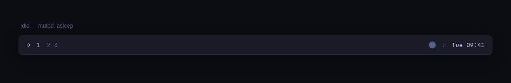
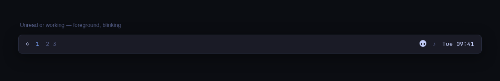
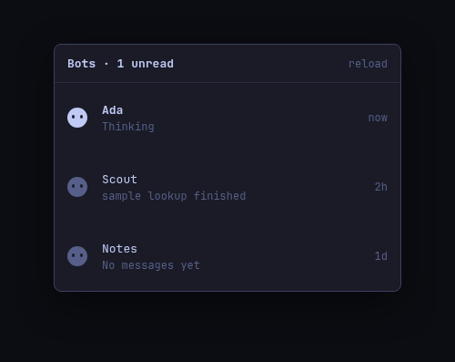
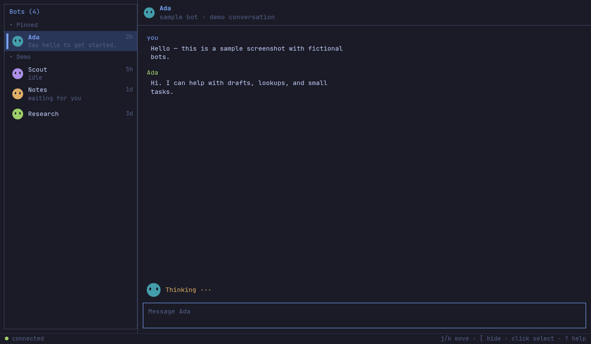

# Grok Bot TUI for Omarchy

[](LICENSE)
[](https://omarchy.org)
[](https://github.com/pixbroker/omarchy-grokbot)
[](https://github.com/omacom/omarchy-plugin-marketplace)
[](https://github.com/pixbroker/grok-bot-rust)
[](https://github.com/pixbroker/omarchy-grokbot)

Unofficial community bar widget for the **native Rust Grok Bot TUI** (`grokbot-tui`).

The Grok Bot mark is always in the bar. Beside it are the bots waiting on you, drawn as themselves. Click the mark for the roster; click a row to open that bot in the Rust TUI. The mark dims when the snapshot writer is gone (app not running, or the file is older than two minutes).

**Omarchy theme.** The widget uses the shell palette so it restyles when you `omarchy theme set`. The TUI reads the same current theme file (`~/.local/state/omarchy/current/theme/colors.toml`) and reloads live (file watch + SIGUSR2).

This plugin is **not** Grok Bot, and it is **not** an xAI or Cursor product. It is also not the Electron Linux desktop client (`/usr/bin/grokbot`).

Faces, flourishes, roster ordering and the local-state reader are adapted from [omabot](https://github.com/njpatel/omabot) by Neil Patel (Apache-2.0).

## Screenshots

Demo frames only. Fictional bots (`Ada`, `Scout`, `Notes`, `Research`) — not a capture of anyone’s real list, chat, or account.

**Bar — sleeping** (idle, `Color.muted`, eyes shut):



**Bar — awake** (unread or a bot working, `Color.foreground`):



**Inbox panel** (click the face):



**Rust TUI** (`grokbot-tui`):



## Privacy

The widget does not read tokens, chats, emails, or usage APIs. It does **not** poll or exec `grokbot-tui inbox`. It watches `~/.local/state/grok-bot-rust/inbox.json` (names, titles, last-message previews, shapes and colours only), written by the TUI or `grokbot-tui inbox --local --watch`. Files larger than 64KiB are rejected. Opening a bot uses a Quickshell `Process` **argv** (`omarchy-launch-or-focus-tui`, `--app-id=…`, `grokbot-tui`, `open`, `<id>`). Bot ids are allowlisted (`[A-Za-z0-9._:-]`, max 80). Avatar pictures, if present, must be an absolute path under `$HOME` ending in `.png`/`.jpg`/`.jpeg`/`.webp`. Launch has an 8s timeout. At most 24 bots; string fields clipped. CLI-derived `Text` uses `textFormat: Text.PlainText`. Never `/usr/bin/grokbot`. Schema 1 snapshots still work (circle avatars, flat order).

## What you need

- Omarchy with `omarchy-shell`
- **`grokbot-tui`**, installed from the pinned git revision below (Cargo.lock, `--locked`)

### grokbot-tui (immutable, source-verifiable)

This is the only supported install. It fetches [pixbroker/grok-bot-rust](https://github.com/pixbroker/grok-bot-rust) at a **fixed commit** and builds with `--locked`:

```bash
cargo install --git https://github.com/pixbroker/grok-bot-rust.git \
  --rev 11f991bbbae21bc810461e4f6fd7dedc30e213d6 \
  --locked \
  --bin grokbot-tui
```

That places `~/.cargo/bin/grokbot-tui`. The widget also accepts `~/.local/bin/grokbot-tui`. Then:

```bash
grokbot-tui login
mkdir -p ~/.config/systemd/user
# from the grok-bot-rust tree:
cp contrib/systemd/grokbot-inbox.service ~/.config/systemd/user/
systemctl --user enable --now grokbot-inbox.service
```

Prefer `grokbot-tui inbox --local --watch` (or the systemd unit from the TUI tree): it rewrites the snapshot from local state and needs no session. The TUI writes the same file while it is open.

Verify:

```bash
command -v grokbot-tui
test -s ~/.local/state/grok-bot-rust/inbox.json
```

Do not copy an unsigned local `target/release` build, and do not use Electron `/usr/bin/grokbot`.

## Install

Plugins run unsandboxed inside `omarchy-shell`. Read this repository first.

```bash
omarchy plugin add https://github.com/pixbroker/omarchy-grokbot.git --enable
```

```bash
omarchy plugin remove pixbroker.grokbot
```

## Use

### Bar

The mark is always there. Beside it, by default, are up to three bots that want you (waiting, working, then unread), newest first.

| | |
| --- | --- |
| click | open the panel |
| right-click | open **`grokbot-tui`** (no bot id) |
| middle-click | cycle what sits beside the mark: avatars · count · none |
| hover | tooltip with counts; the bar avatars look up one after another |

### Panel

Bots waiting on you come first (longest wait at the top), then a rule, then everyone else by recency. Avatars greet when the panel opens; their eyes follow the pointer over the list.

| key | |
| --- | --- |
| `j` `k` | move |
| `Enter` | open that bot in **`grokbot-tui`** |
| `g` | cycle the order: attention · channels · flat |
| `h` | redact names and messages (for screen sharing; ids are never redacted) |
| `r` | cycle what sits beside the mark |
| `Esc` | close |

### Faces

| | |
| --- | --- |
| eyes up, leaning in | waiting on your answer |
| wide-eyed | more than one unread message |
| head tilted | one unread message |
| half-closed | nothing for a week |
| level | up to date |

A bot that is working says `thinking…` in place of its last line. A row that goes from wanted to not-wanted takes a bow.

### Demo

`omarchy-shell pixbroker.grokbot demo` swaps in a staged roster (fourteen invented bots across ACME and Personal) so screenshots need no writer. Call it again for the live snapshot.

## Settings

Set on the bar entry, or with the keys above:

| Key | Default | What it does |
| --- | --- | --- |
| command | grokbot-tui | Basename `grokbot-tui` or an absolute path ending in `/grokbot-tui` |
| appId | org.omarchy.grokbot-tui | Window id used to focus an existing TUI |
| barMetric | avatars | What sits beside the mark: `avatars` · `count` · `none` |
| ordering | attention | Panel order: `attention` · `channels` · `flat` |
| groupBySection | true | When ordering is channels, group by snapshot sections |
| maxBarAvatars | 3 | Most avatars to show in the bar (1–6) |

```bash
omarchy bar set pixbroker.grokbot barMetric count
omarchy bar set pixbroker.grokbot ordering channels
omarchy bar set pixbroker.grokbot maxBarAvatars 4
```

## Validate

```bash
omarchy plugin validate .
```
